# African Credit Scoring Challenge

<div align="center">
<h2>Predicting loan default risk across African markets</h2>
<p>A reproducible machine-learning study with exploratory analysis, an imbalanced-data ensemble, a credit scorecard, and monitoring outputs.</p>
</div>

| Research question | Main metric | Current internal result | Data scope |
|---|---:|---:|---|
| Can loan, customer, lender, date, and economic data identify default risk? | F1 for default class | **0.8963 OOF F1** after threshold and segment tuning | 68,654 training rows; Kenya-only labels |
| How does the model score unseen applications? | Probability of default | 18,594 test rows scored; 680 classified as defaults | Test includes 3,525 Ghana rows |

> **Interpretation note:** the OOF result is an optimized development estimate. Rows sharing customers and loan IDs can cross the random CV folds, and aggregate features are currently built before fold splitting. Read the score with the validation caveats in [Evaluation and limitations](#evaluation-and-limitations).

<details open>
<summary><strong>Contents</strong></summary>

1. [Research purpose](#research-purpose)
2. [Data and exploratory analysis](#data-and-exploratory-analysis)
3. [Methodology](#methodology)
4. [Evaluation and results](#evaluation-and-results)
5. [Scoring and monitoring](#scoring-and-monitoring)
6. [Conclusion and next steps](#conclusion-and-next-steps)
7. [Run the workflow](#run-the-workflow)
8. [Notebook figure archive](#notebook-figure-archive)

</details>

## Research purpose

Credit providers need to estimate the probability that a borrower will default so they can price risk, manage lending exposure, and make more consistent decisions. This project studies whether the available loan-level data can support that decision across customers and markets with different economic conditions.

The challenge target is binary: **1 means default; 0 means no default**. The competition asks for a default prediction, evaluated with F1. This work also produces a probability of default, a transparent 300-850 score, risk bands, feature importance, and data-drift summaries.

The analysis has two practical questions:

- Which repayment, loan, customer-history, lender, timing, and economic signals are useful for identifying defaults?
- How well does a model developed on the labeled market transfer to the unseen test population?

The second question is especially important here: the labeled training data are from Kenya, while the test set also contains Ghana applications.

## Data and exploratory analysis

### Dataset snapshot

| Item | Training data | Test data |
|---|---:|---:|
| Rows | 68,654 | 18,594 |
| Columns | 16, including target | 15 |
| Countries | Kenya: 68,654 | Kenya: 15,069; Ghana: 3,525 |
| Date coverage | 2021-10-04 to 2024-11-14 | 2021-11-08 to 2024-11-14 |
| Exact duplicate rows | 0 | 0 |
| Raw missing values | 0 | 0 |

The test set's Ghana rows are **18.96%** of the test data. Ghana is absent from the labeled training set, so these predictions are out-of-country extrapolations rather than a validated Ghana result.

### Target balance and customer behavior

There are **1,258 defaults out of 68,654 training rows**, a default prevalence of **1.83%**. That is roughly 54 non-default rows for every default row. Accuracy alone would hide poor detection of defaults, which is why F1 is the primary metric and recall and precision are reported alongside it.

| Segment | Rows | Defaults | Observed default rate |
|---|---:|---:|---:|
| New Loan | 567 | 119 | 20.99% |
| Repeat Loan | 68,087 | 1,139 | 1.67% |

This large difference makes repeat/new status and customer-history features potentially informative. Loan type also varies sharply: Type 14 has 71 defaults among 99 rows (71.7%), Type 23 has 13 among 18 (72.2%), and Type 2 has 45 among 74 (60.8%). Those high rates come from small groups, so they need minimum-support rules before being used as policy.

The data contain multiple lender records for some loans: 68,654 rows represent 66,520 unique `tbl_loan_id` values. That structure motivated evaluating loan-level probability aggregation.

### Distribution, missingness, and market coverage

The raw train and test files have no missing values and no exact duplicate rows. After the notebook joins annual economic indicators, each of the nine macroeconomic variables has 2,970 missing training values (4.33%). The source indicators end in 2023, while some loans are from 2024; the notebook therefore imputes those unmatched macro values. The Python feature pipeline caps the macro lookup year at the latest available year.

Loan amounts are strongly right-skewed: the median is 5,249, the 99th percentile is 119,411, and the maximum is 23,000,000 dataset units. Duration has a median of 7 days and a maximum of 1,096 days. Log features and robust scaling are used to reduce the influence of scale and extremes; the original records are retained.

### What the EDA changed in the modeling plan

| EDA finding | Modeling implication |
|---|---|
| Defaults are only 1.83% of rows | Use stratified validation, train-fold resampling, and tune the decision threshold for F1. |
| New and repeat loans have very different observed default rates | Preserve `New_versus_Repeat` and add customer-history features. |
| Loan amount and duration are heavily skewed | Add ratios and log transforms; use robust scaling before distance-based SMOTE. |
| Economic variables are missing after the country/year join | Impute numeric features and cap years to the indicator coverage. |
| Loan types have different rates, with sparse high-risk groups | Keep loan type and only learn segment thresholds where support is adequate. |
| A loan can appear in several lender rows | Compare no grouping, mean, and maximum probability per `tbl_loan_id`. |
| Test contains Ghana but labeled training data do not | Treat Ghana results as unvalidated; report market-level drift and require Ghana labels for proper validation. |

### Selected EDA figures

<table>
<tr>
<td width="50%"><strong>Default class imbalance</strong><br>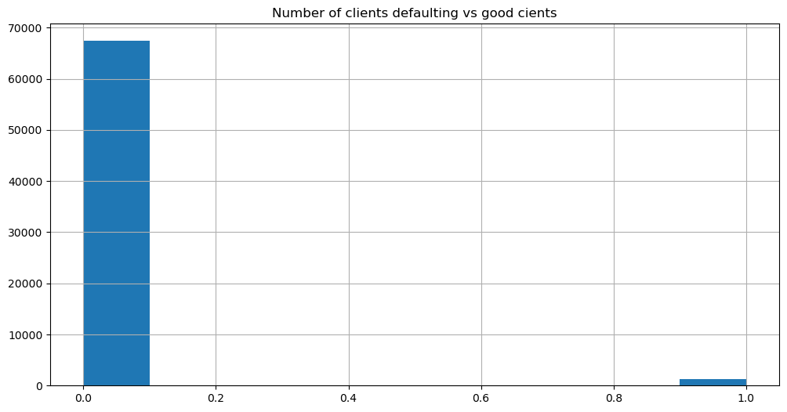</td>
<td width="50%"><strong>Default rate by loan type</strong><br>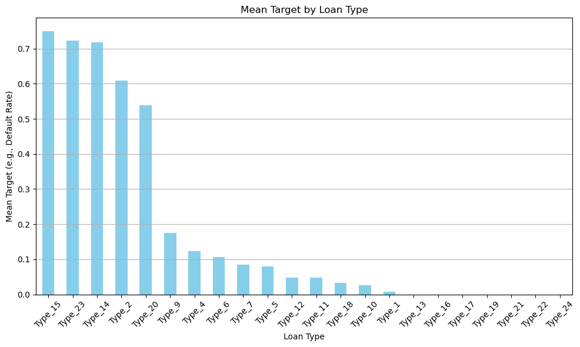</td>
</tr>
<tr>
<td width="50%"><strong>New versus repeat loans</strong><br>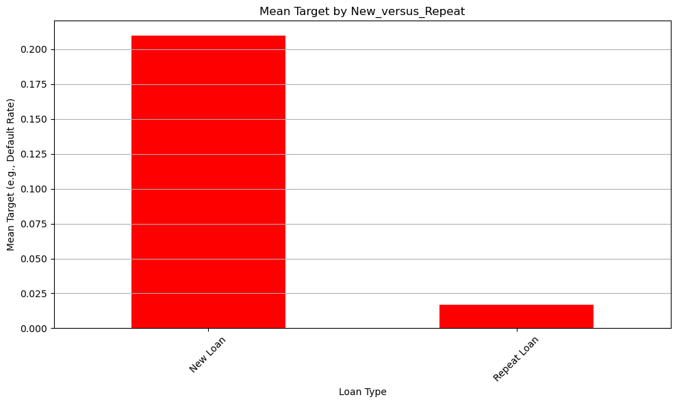</td>
<td width="50%"><strong>Numeric distributions</strong><br>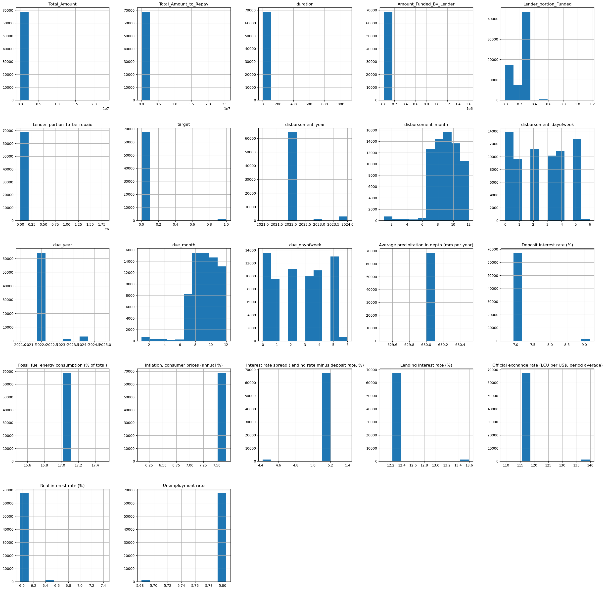</td>
</tr>
<tr>
<td width="50%"><strong>Missingness after macroeconomic join</strong><br>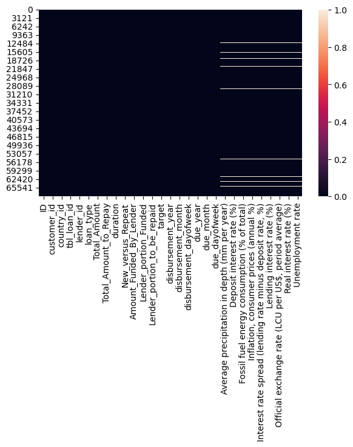</td>
<td width="50%"><strong>Outliers in numeric features</strong><br>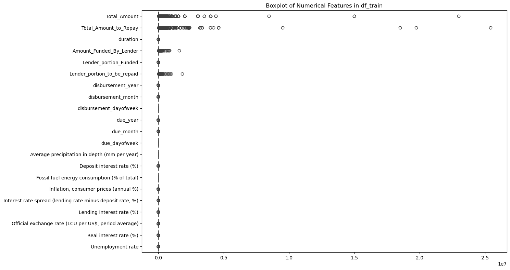</td>
</tr>
</table>

## Methodology

### Feature engineering

The Python workflow in `src/features.py` builds a consistent set of features for train and score data:

- Calendar fields and loan-term differences from disbursement and due dates.
- Repayment-to-principal ratios, repayment spread, amount-per-day, lender-funding ratios, and log amounts.
- Annual macroeconomic indicators joined by country and disbursement year.
- Input-only aggregates for customer, lender, and country/loan-type history.
- Loan-level lender count and funding-share features.

The final pipeline uses **91 engineered model features**. Raw identifiers are retained as categorical inputs, which can help capture repeated entities but also increases the need for customer- and loan-grouped validation.

### Preprocessing and imbalance

Numeric values are median-imputed and robust-scaled. Categorical values are ordinal-encoded, with unseen categories assigned `-1`. Robust scaling helps the distance calculation used by BorderlineSMOTE; tree models themselves do not require normalized feature scales.

BorderlineSMOTE is applied to each training fold only, increasing the minority-to-majority ratio toward 0.45. A positive-class weight is also applied to the resampled fold. Validation rows are not resampled.

### Models and decision rule

The final estimator averages predicted default probabilities from **LightGBM, XGBoost, and CatBoost**. An equal-weight probability blend uses the different boosted-tree learners to reduce reliance on one model's decision boundaries.

The global threshold is selected against out-of-fold predictions to maximize F1. The workflow then compares three loan-level rules: no adjustment, mean probability per `tbl_loan_id`, and maximum probability per `tbl_loan_id`. The maximum rule performed best in this run. Supported country/loan-type groups receive their own threshold when they have at least 250 rows and 5 defaults; smaller groups use the global threshold.

## Evaluation and results

### Cross-validation performance

The reported fold metrics use a threshold optimized within each validation fold. The final OOF metric applies the chosen loan aggregation and supported segment thresholds.

| Metric | Mean across 4 folds |
|---|---:|
| F1 | 0.8931 |
| Precision | 0.8971 |
| Recall | 0.8895 |
| ROC-AUC | 0.9972 |

| Development decision | Threshold | OOF F1 |
|---|---:|---:|
| No loan-level adjustment | 0.7079 | 0.8918 |
| Mean probability per loan | 0.7125 | 0.8923 |
| Maximum probability per loan | 0.7158 | 0.8935 |
| Maximum probability plus supported segment thresholds | 0.7158 global threshold | **0.8963** |

The fold-level F1 scores were 0.8826, 0.9021, 0.8935, and 0.8943. Fold ROC-AUC ranged from 0.9956 to 0.9988. The competition metric is F1, so the threshold is not fixed at 0.5.

### Earlier notebook baselines

The notebook also evaluated single-model baselines on one stratified 80/20 split, using a fixed 0.70 threshold in its shared metrics helper. These results are historical context and are **not directly comparable** with the newer four-fold ensemble evaluation above.

| Notebook baseline | Precision | Recall | F1 | ROC-AUC |
|---|---:|---:|---:|---:|
| Decision Tree | 0.1851 | 0.6056 | 0.2836 | 0.8474 |
| Random Forest | 0.7122 | 0.3944 | 0.5077 | 0.9641 |
| LightGBM | 0.8209 | 0.6574 | 0.7301 | 0.9826 |
| XGBoost | 0.5820 | 0.5936 | 0.5878 | 0.9723 |

The notebook's LightGBM calibration summary was Brier score 0.0075, log loss 0.0299, and expected calibration error 0.1216. These calibration numbers belong to the earlier single split, not the current ensemble.

### Feature importance

The chart and table below average each model's normalized built-in tree importance. Importance describes how much a feature was used by these fitted models; it is not a causal effect.

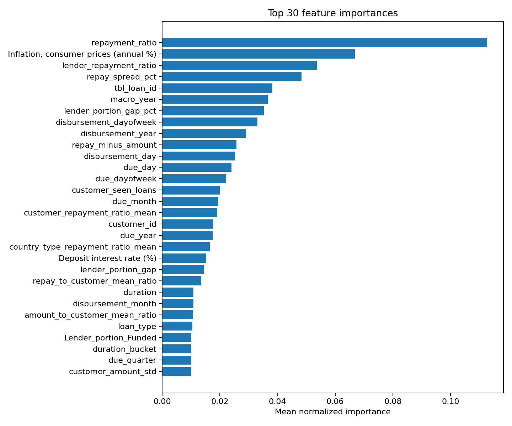

| Rank | Feature | Mean normalized importance |
|---:|---|---:|
| 1 | Repayment ratio | 0.1127 |
| 2 | Inflation, consumer prices | 0.0668 |
| 3 | Lender repayment ratio | 0.0536 |
| 4 | Repayment spread percentage | 0.0484 |
| 5 | Loan ID (`tbl_loan_id`) | 0.0382 |
| 6 | Macro year | 0.0366 |
| 7 | Lender portion gap percentage | 0.0352 |
| 8 | Disbursement weekday | 0.0331 |
| 9 | Disbursement year | 0.0289 |
| 10 | Repayment minus principal | 0.0258 |

The prominence of repayment ratios is consistent with the loan-risk task. The contribution from `tbl_loan_id` and timing fields should be checked under a grouped or forward-in-time split to rule out identifier and temporal leakage.

## Scoring and monitoring

### Test scoring output

The unlabeled test set produced 680 positive predictions (3.66%) and a mean predicted probability of default of 3.89%. No test F1 can be calculated because test labels are not supplied.

| Test score band | Rows | Share |
|---|---:|---:|
| Poor | 776 | 4.17% |
| Fair | 47 | 0.25% |
| Good | 114 | 0.61% |
| Very good | 594 | 3.19% |
| Excellent | 17,063 | 91.77% |

The scorecard maps model probability and available customer history onto a 300-850 range. The weights and band labels are an illustrative challenge scorecard, not a validated lending policy or a calibrated regulatory score.

### Drift monitoring

Population Stability Index (PSI) compares the training feature distribution with the scored test distribution. The monitoring code labels PSI below 0.10 as stable, 0.10-0.25 as watch, and 0.25 or higher as drift.

| Feature | PSI | Status |
|---|---:|---|
| Interest rate spread | 1.141 | Drift |
| Lender mean funded ratio | 0.671 | Drift |
| Deposit interest rate | 0.271 | Drift |
| Inflation | 0.271 | Drift |
| Lending interest rate | 0.271 | Drift |
| Customer amount mean | 0.235 | Watch |
| Customer seen-loan count | 0.226 | Watch |

The macroeconomic and lender shifts warrant review. PSI flags changes in feature populations; without test outcomes it cannot tell us whether model accuracy has deteriorated. The Kenya-to-Ghana shift is a particular concern because Ghana has no labels in the training set.

## Conclusion and next steps

The engineered ensemble separates default risk well in the current random, stratified Kenya cross-validation, with an optimized OOF F1 of 0.8963. Repayment behavior, macroeconomic conditions, and loan structure rank highly, and loan-level maximum aggregation and supported segment thresholds improve the development score.

The result is promising but not yet a reliable estimate of performance on new customers or new countries. Customer and loan IDs repeat across rows, aggregate features are built before the CV folds, and the same OOF data are used to tune global and segment thresholds. These choices can make the reported score optimistic. The Ghana portion of the test set is also outside the labeled training geography.

Recommended next steps are to:

1. Rebuild validation so customers and `tbl_loan_id` groups cannot cross folds; fit all aggregates and preprocessing inside each fold.
2. Add a forward-in-time validation and a Ghana holdout once labeled Ghana outcomes are available.
3. Re-evaluate identifier features and segment thresholds on an untouched holdout.
4. Calibrate probabilities and validate the scorecard weights before using scores for lending decisions.
5. Track PSI, default prevalence, F1, recall, precision, and calibration once outcomes mature.

## Run the workflow

Install the dependencies:

```bash
pip install -r requirements.txt
```

Train the ensemble and regenerate CV, feature-importance, and monitoring-reference artifacts:

```bash
python train.py
```

Score the provided test data and write the Zindi submission, per-row scorecard, and drift reports:

```bash
python score.py
```

Key outputs:

| Artifact | Contents |
|---|---|
| `submission.csv` | Competition submission with `ID,Target` |
| `model/model_bundle.pkl` | Feature builder, preprocessor, ensemble, threshold, and monitoring profile |
| `reports/scored_loans.csv` | Default probability, prediction, credit score, and risk band per row |
| `reports/cv_fold_metrics.csv` | Four-fold validation metrics |
| `reports/feature_importance.csv` and `reports/feature_importance.png` | Model-averaged feature importance |
| `reports/monitoring/` | PSI drift, prediction summary, and score-band distribution |
| `reports/figures/` | All 28 image outputs recovered from the training notebook |

## Notebook figure archive

The following figures were exported from the saved notebook outputs and given descriptive names. Expand a section to inspect the plots.

<details>
<summary><strong>Exploratory data analysis</strong></summary>

**Missing values after the macroeconomic join**


**Training missingness check**

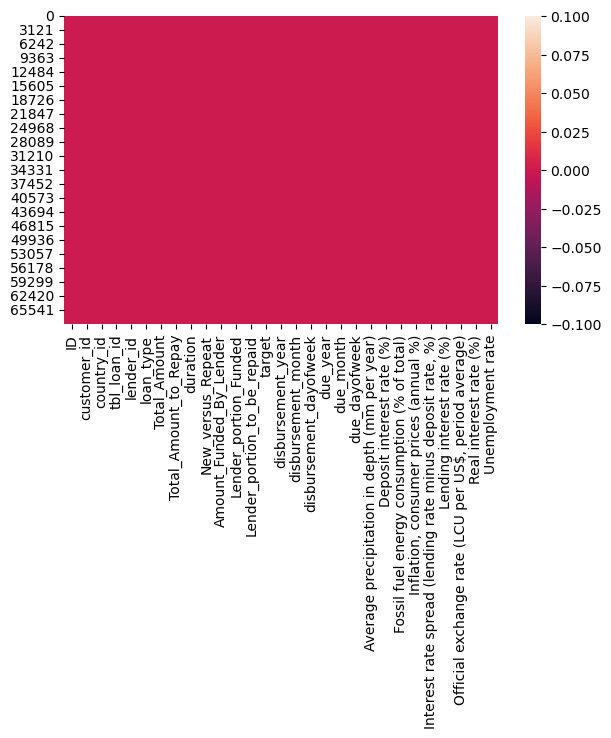

**Test missingness check**

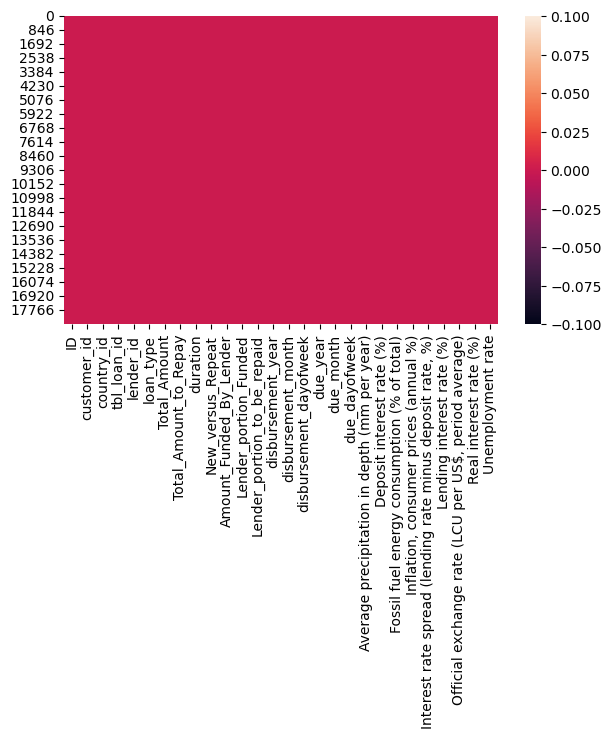

**Numeric feature distributions**


**Default rate by loan type**


**Default rate for new and repeat loans**


**Target class imbalance**


**Numeric feature correlation**

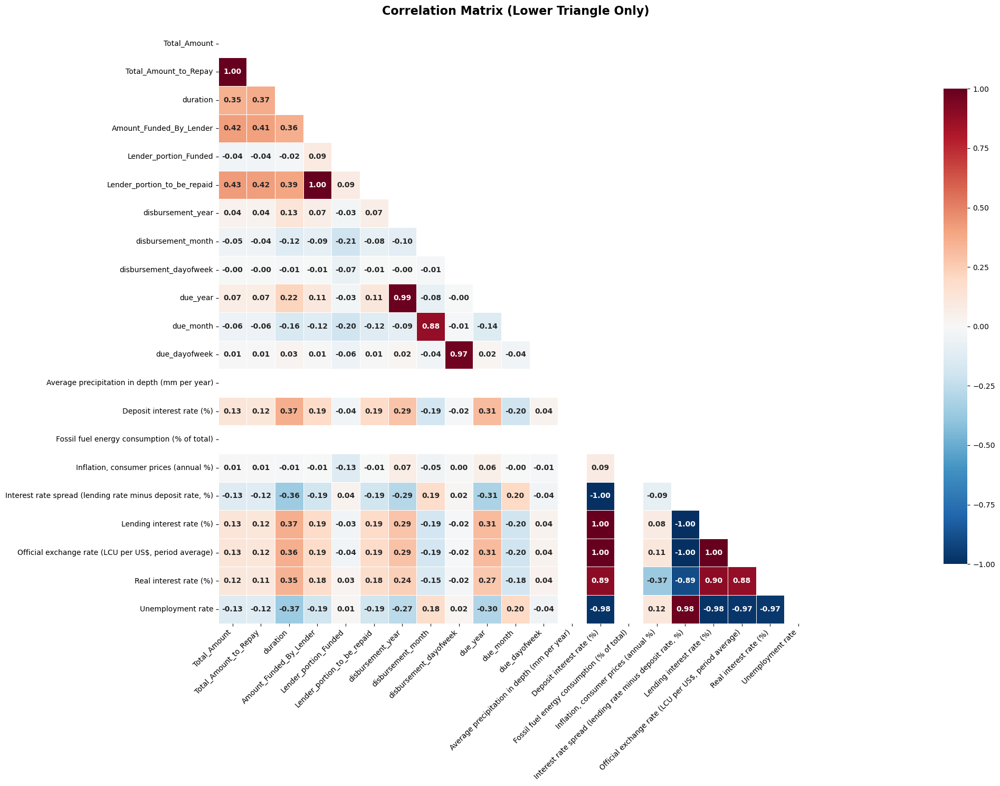

**Numeric feature outliers**


**Class balance after SMOTE**

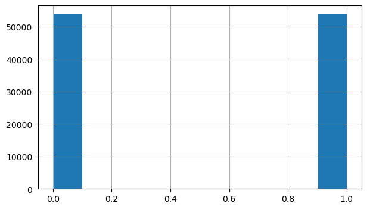

</details>

<details>
<summary><strong>Model diagnostics and calibration</strong></summary>

These diagnostic plots come from the earlier single-split notebook baselines. Their confusion matrices use the notebook helper's 0.70 probability threshold, except the explicitly labeled zero-threshold LightGBM plot.

**Decision Tree: ROC curve**

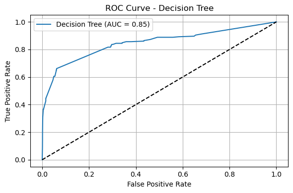

**Decision Tree: precision-recall curve**

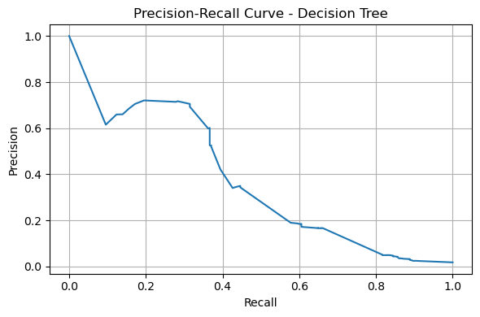

**Decision Tree: confusion matrix**


**Decision Tree: probability distribution**

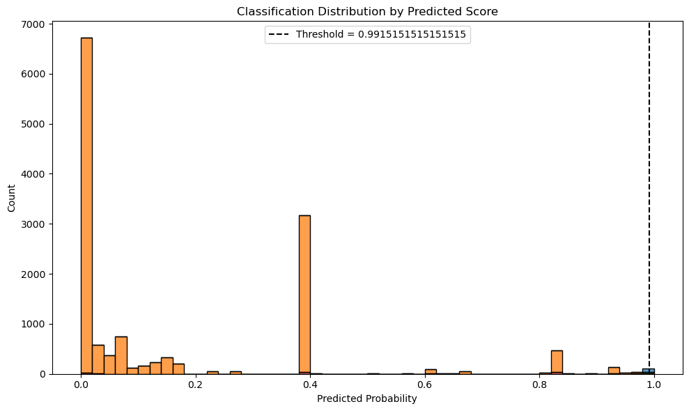

**Random Forest: ROC curve**

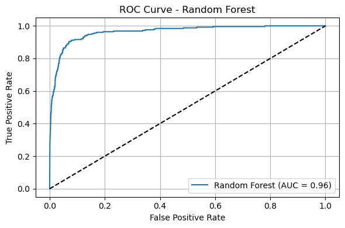

**Random Forest: precision-recall curve**

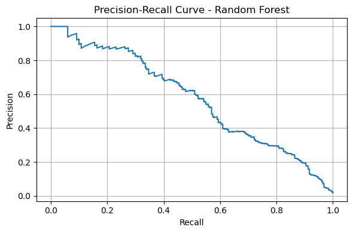

**Random Forest: confusion matrix**


**Random Forest: probability distribution**

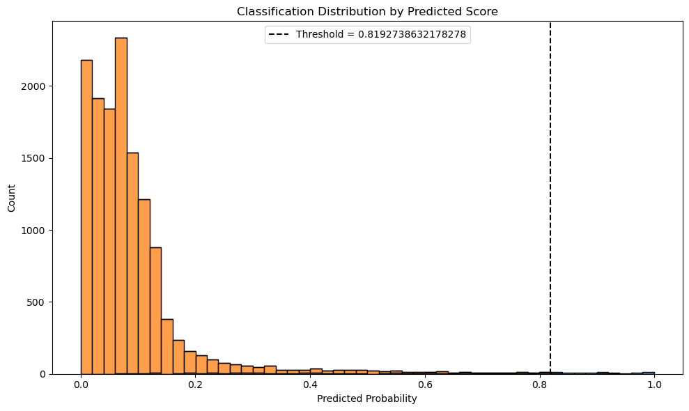

**LightGBM: ROC curve**

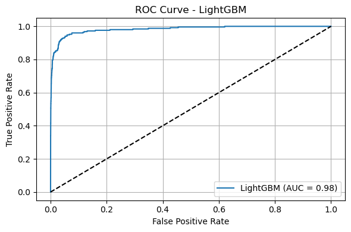

**LightGBM: precision-recall curve**

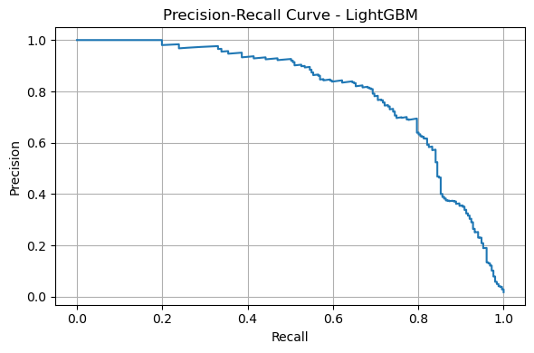

**LightGBM: confusion matrix**

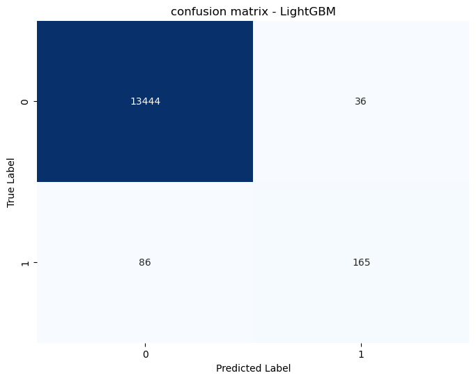

**LightGBM: probability distribution**

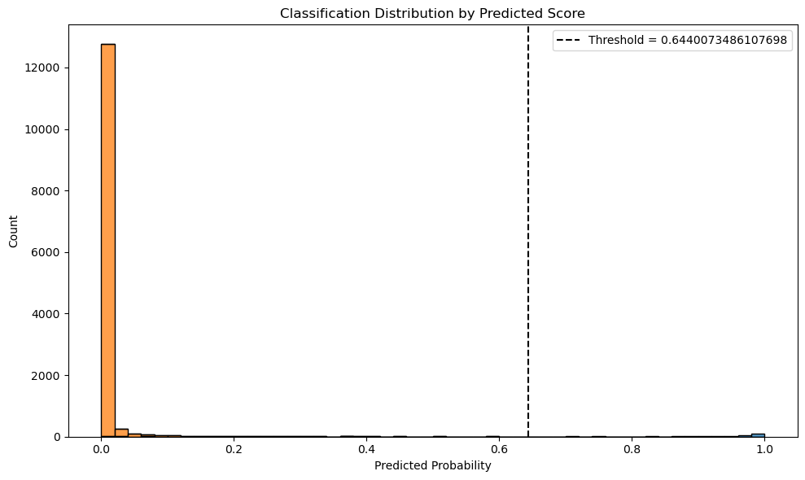

**LightGBM: zero-threshold diagnostic**

This notebook plot predicts positive for any probability greater than zero; it is preserved for completeness and should not be interpreted as a useful operating threshold.

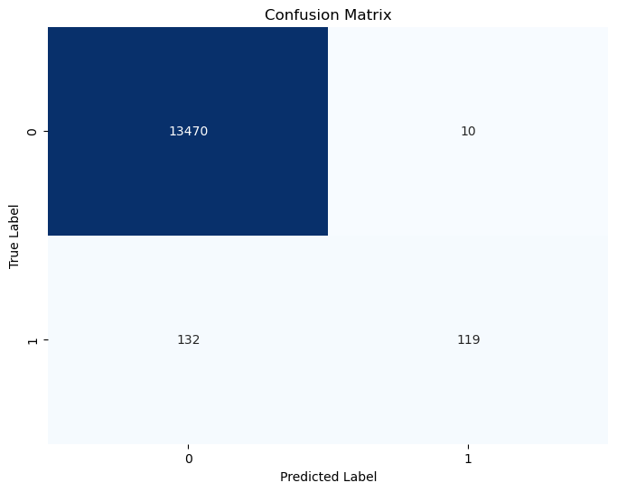

**XGBoost: ROC curve**

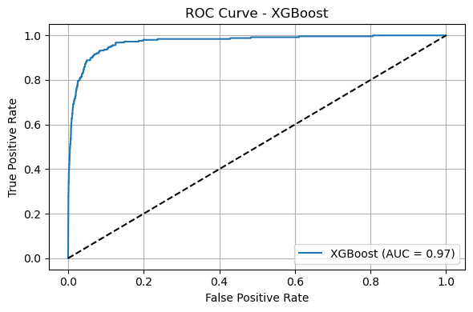

**XGBoost: precision-recall curve**

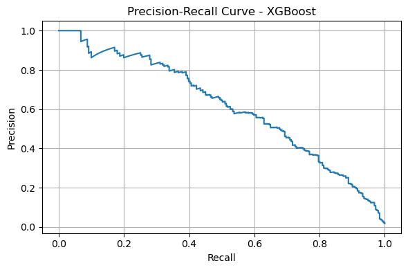

**XGBoost: confusion matrix**


**XGBoost: probability distribution**

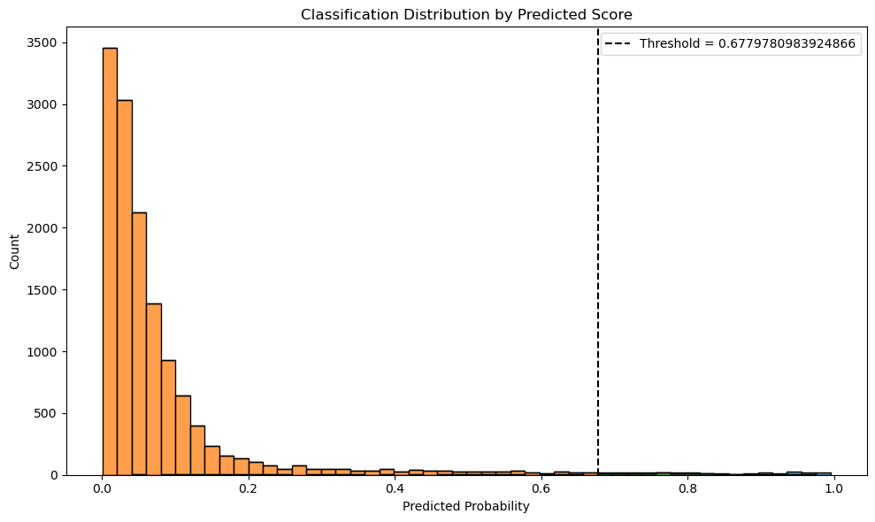

**Notebook calibration curves**

This calibration plot evaluates the earlier individual models, not the current three-model ensemble.

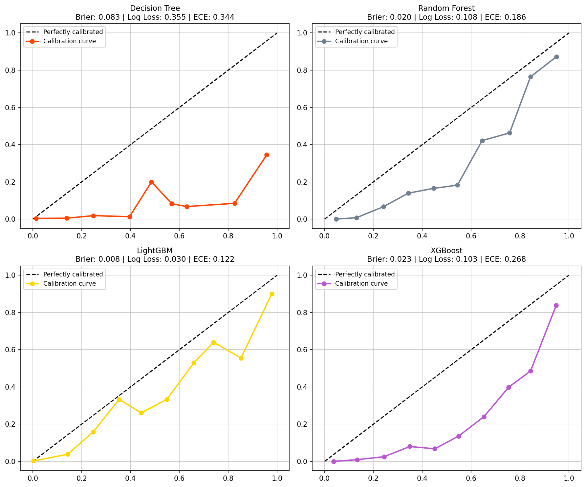

</details>

